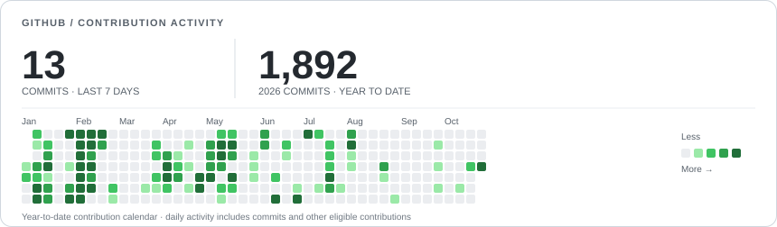

# Hi, I'm CCLUCKY 👋

**Building AI where business already happens.**

A Java backend developer working on **AI transformation inside a traditional enterprise**. I'm part of the core team bringing agents, knowledge systems, and LLM infrastructure into production—and keeping them running.

[Personal site](https://ai-native-identity.vercel.app) · [X](https://x.com/cclove057) · [Xiaohongshu](https://www.xiaohongshu.com/user/profile/6782efb3000000000803f751) · WeChat: **CCLUCKY 的逻辑碎片**

  

### What I'm shipping

| **01 / Digital workforce** | **02 / AI in business workflows** |
| :--- | :--- |
| **Developer · Reviewer · Knowledge · Maintainer** Four production agents supporting software development, code review, knowledge access, and maintenance. | **NL2SQL · Workflow automation** AI integrated into existing enterprise systems and everyday operations. |
| **03 / Enterprise knowledge** | **04 / LLM infrastructure** |
| **Baishitong AI assistant · RAGFlow · Agentic RAG** A production knowledge base and WeCom assistant, backed by document processing, embeddings, and reranking. | **LLM gateway · vLLM · SGLang** Unified model access, local inference, and the reliability work needed to support real applications. |

### Beyond the day job

I also build [WeCom CLI](https://github.com/ccclucky/wecom-cli), explore [Agent Time](https://github.com/ccclucky/agent-time), and contribute fixes to projects I use, including [RAGFlow](https://github.com/infiniflow/ragflow). I'm especially interested in **Agent reliability, retrieval quality, and what happens after deployment**.

<b>More GitHub activity</b> · Detailed statistics, contribution history & streaks

  

